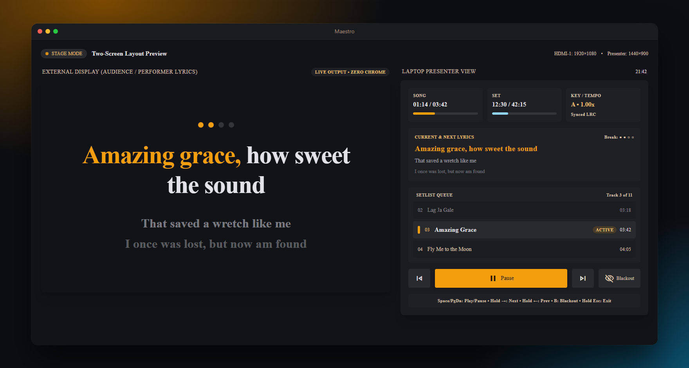
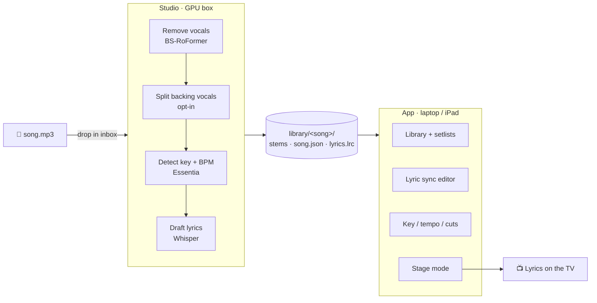
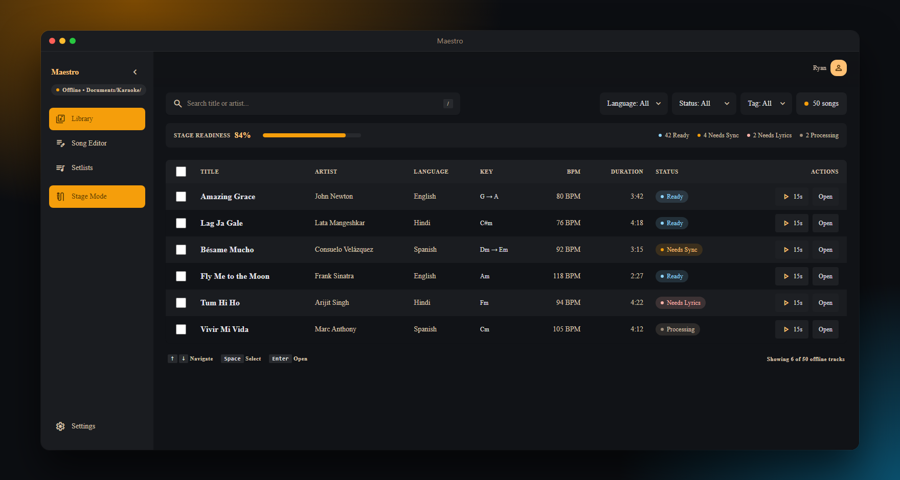
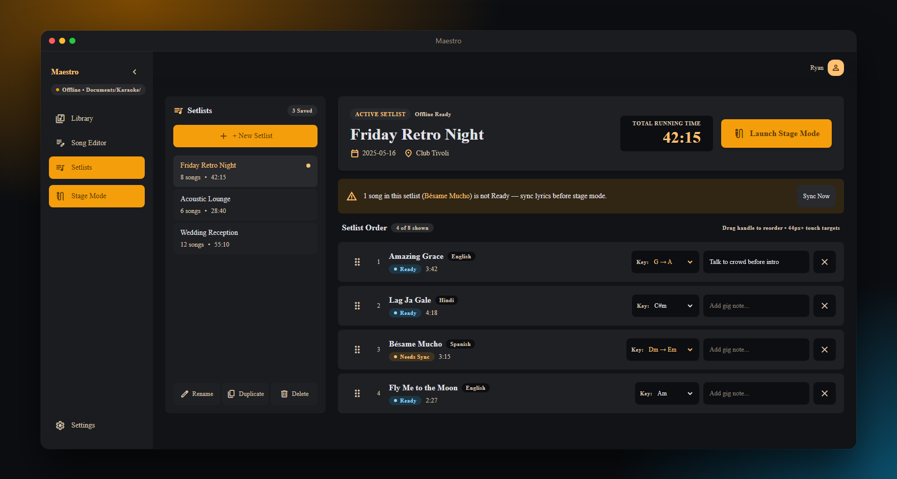
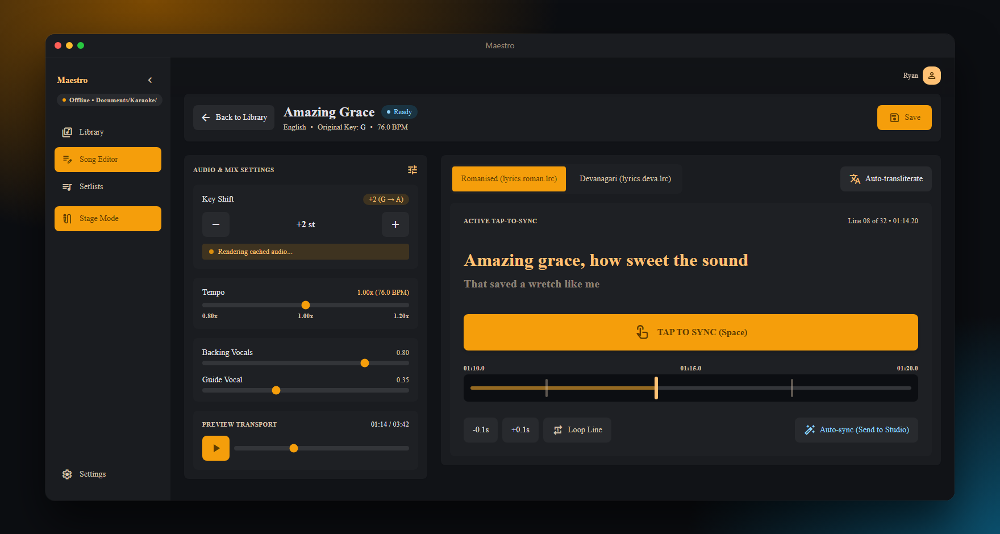
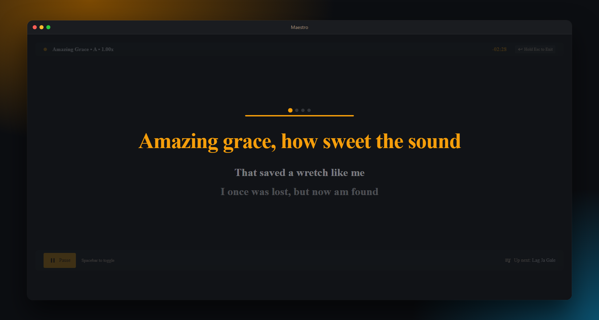

# 🎤 Maestro

**A personal, offline, stage-ready karaoke app.**
Drop in a song. Get a backing track, synced lyrics and a show you can run from a laptop.

-111317)

*Maestro (Italian, from Latin* magister*): the one who runs the show.*

---

## Why

Most karaoke apps stream from a catalogue, need Wi-Fi and sing in the record's key.
Maestro is built for **one performer doing real gigs**: your own library, your key, your tempo, your lyric edits, and nothing that can break when the venue has no signal.

- 🎚️ **Your key, your tempo.** Real audio is pitch- and time-shifted (no MIDI), so it still sounds like the record.
- 📴 **Fully offline.** No accounts, no cloud, no network calls on stage.
- 🌏 **Four languages.** English, Hindi, Konkani and Spanish, in Romanised or Devanagari script.
- 🖥️ **Runs like PowerPoint.** Presenter view on the laptop, lyrics on the TV, pedal-friendly controls.

## How it works

Two halves, joined by plain files:

| | **Studio** (`studio/`, Python) | **App** (`app/`, Flutter) |
|---|---|---|
| Runs on | A GPU box, in the background | The laptop on stage (iPad later) |
| Job | Turns a song into stems, key, BPM and a lyric draft | Library, setlists, lyric editing and the live show |
| Heavy lifting | Vocal separation, Whisper, forced alignment | Key/tempo render via Signalsmith Stretch (FFI) |

No database: each song is a folder with a `song.json` and an `.lrc` file, so the whole library copies straight to another device.

## Screens

<table>
  <tr>
    <td width="50%"> <b>Library</b>: search, filter and see what's stage-ready.</td>
    <td width="50%"> <b>Setlists</b>: running order, keys, gig notes and total time.</td>
  </tr>
  <tr>
    <td> <b>Song editor</b>: tap-to-sync lyrics, key, tempo and mix.</td>
    <td> <b>Stage mode</b>: one big line, the next two dimmed, nothing else.</td>
  </tr>
</table>

Design mockups, shown with a public-domain song. The built app follows them closely.

## Status

- [x] Vocal separation, backing-vocal split, key and BPM detection
- [x] Whisper lyric drafts and forced alignment
- [x] Library, setlists, song details
- [x] Lyric timing and text editor
- [x] In-app key/tempo render (±semitones, tempo, sample-exact)
- [x] Two-screen presenter and audio trimmer
- [ ] Field tests at a real gig
- [ ] Audio restoration for low-bitrate MP3s
- [ ] iPad build

The full design, decisions and roadmap live in **[SPEC.md](SPEC.md)**.

## Principles

- **Self-hosted.** Audio and model weights never go in git, and no third-party processing services.
- **Start with the wheel, then improve it.** Use the best existing tool behind a swappable adapter, then replace it once there's data to compare against.
- **Nothing heavy on stage.** Everything is rendered ahead of time, so the show can't stutter.
